<p align="center"></p>

<h1 align="center">GeeCompare</h1>

<h3 align="center">Compare and merge anything.</h3>

<p align="center">Folders, text, tables, hex, pictures, documents, media and the registry — fifteen kinds of session in one native app.</p>

<p align="center">
  <a href="https://github.com/cmzy/geecompare/releases/latest"></a>
  
  
  
</p>

<p align="center">
  <a href="#download"><b>Download</b></a> ·
  <a href="https://geecompare.com/">Website</a> ·
  <a href="https://geecompare.com/docs/">Docs</a> ·
  <a href="https://github.com/cmzy/geecompare/releases">Releases</a> ·
  <a href="https://github.com/cmzy/geecompare/issues">Feedback</a> ·
  <a href="README.zh-CN.md">简体中文</a>
</p>

<p align="center"><a href="https://geecompare.com/">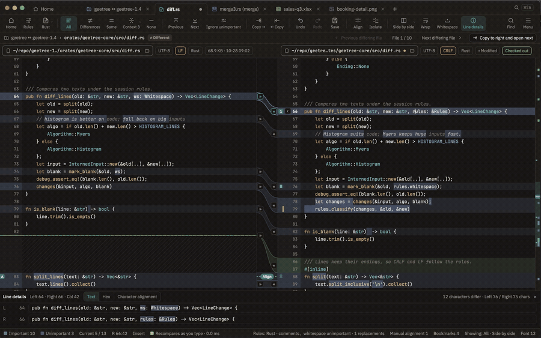</a></p>

<table align="center"><tr><td align="center"><h3>15</h3><sub>kinds of session: folders, text, tables, pictures, documents…</sub></td><td align="center"><h3>12</h3><sub>archive families, compared in place and written back</sub></td><td align="center"><h3>5</h3><sub>SFTP · FTP/FTPS · S3 · WebDAV · SVN</sub></td><td align="center"><h3>3</h3><sub>macOS · Windows · Linux</sub></td></tr></table>

Free to use. No account needed.

## Folders: compare, synchronise, merge

**The rules decide; the verdict is one glance away.** Compare by size, time, checksum or byte for byte; filter, flatten, and jump to the next difference with F7. Copying, moving, renaming and deleting run in the background, can be paused and cancelled, and deletions go to the Trash.

<picture><source media="(prefers-color-scheme: dark)" srcset=".github/media/folder-en-dark.gif">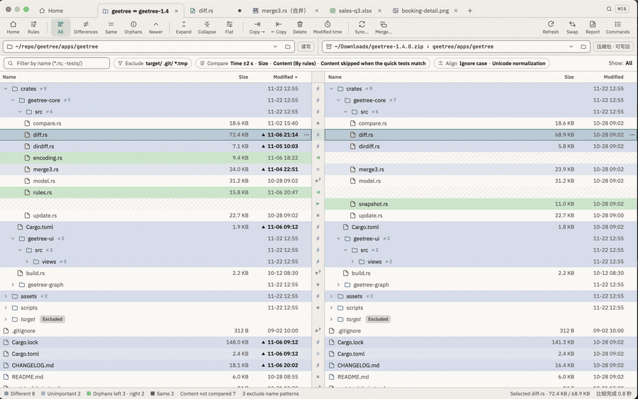</picture>

Five ways to synchronise, each previewed before it runs, and two- and three-way folder merges that hand you a plan you can edit.

<table>
<tr><td width="50%" align="center" valign="top"><picture><source media="(prefers-color-scheme: dark)" srcset=".github/media/sync-en-dark.jpg">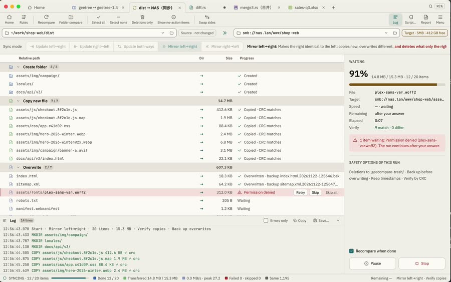</picture><br><sub>Synchronise</sub></td><td width="50%" align="center" valign="top"><picture><source media="(prefers-color-scheme: dark)" srcset=".github/media/foldermerge-en-dark.jpg">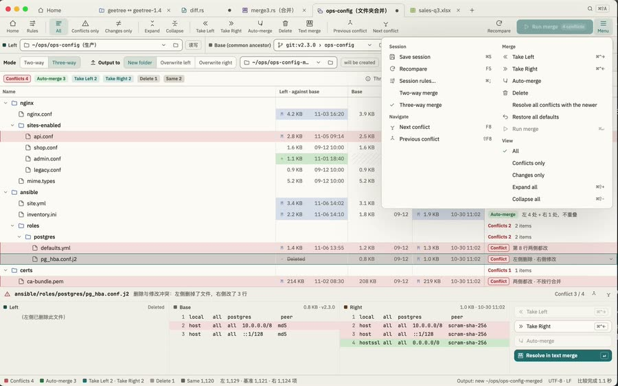</picture><br><sub>Folder merge</sub></td></tr>
</table>

## Text: edit both sides, recompared as you type

Both sides are editable and the comparison is redone as you type. Important and unimportant differences are coloured apart, and the rules are yours: case, whitespace, comments, replacements, alignment by grammar.

<picture><source media="(prefers-color-scheme: dark)" srcset=".github/media/text-en-dark.gif">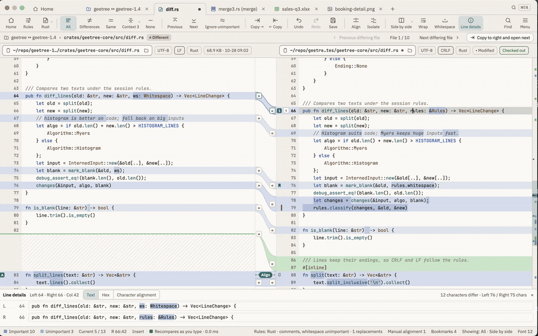</picture>

Side by side, over-under or unified, with connectors, bookmarks, manual alignment and find and replace.

<table>
<tr><td width="100%" align="center" valign="top"><picture><source media="(prefers-color-scheme: dark)" srcset=".github/media/textrules-en-dark.jpg">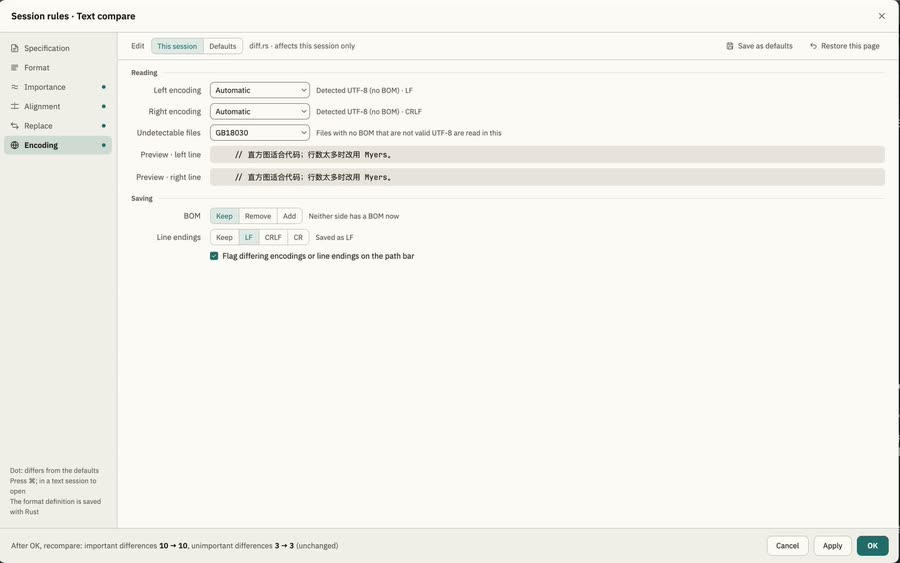</picture><br><sub>Session rules, with the counts recalculated live</sub></td></tr>
</table>

## Three-way merge and patches

A three-way merge with an output pane of its own and conflict-by-conflict navigation, opened straight from `git mergetool`; two-way merges work the same way.

<picture><source media="(prefers-color-scheme: dark)" srcset=".github/media/merge-en-dark.gif">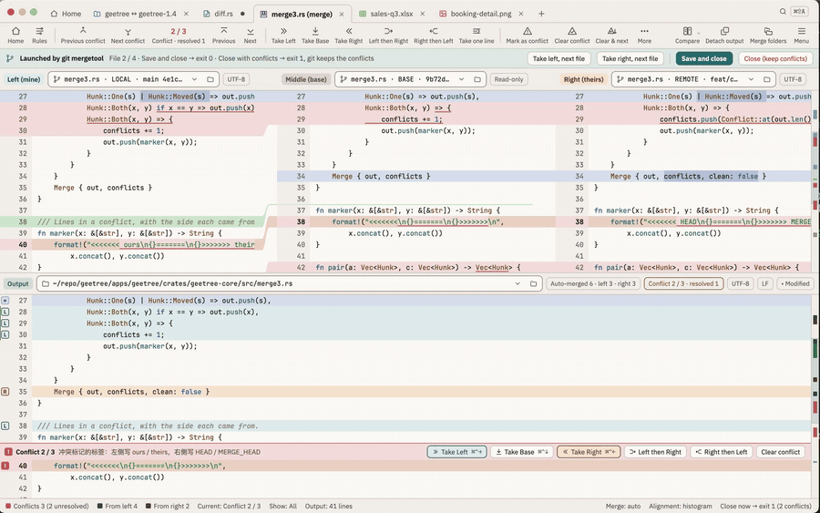</picture>

<table>
<tr><td width="100%" align="center" valign="top"><picture><source media="(prefers-color-scheme: dark)" srcset=".github/media/patch-en-dark.jpg">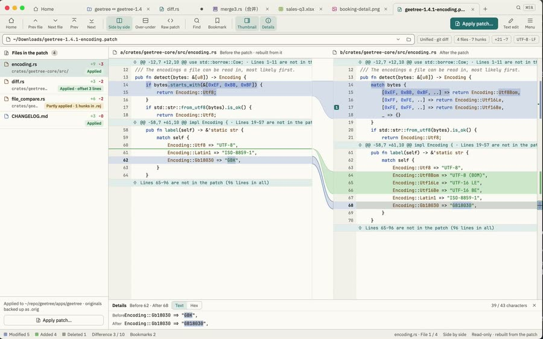</picture><br><sub>Patch files are shown side by side, and can be applied to a working copy</sub></td></tr>
</table>

## More than text

Tables and Excel (several worksheets, key columns, tolerances, column mapping), hex (editable, aligned, with a value bar), pictures (side by side, overlay, swipe, difference, blink, and a pixel magnifier), PDF, Word, RTF and HTML compared as text, media tags, executable version information, and the registry.

<table>
<tr><td width="50%" align="center" valign="top"><picture><source media="(prefers-color-scheme: dark)" srcset=".github/media/table-en-dark.jpg">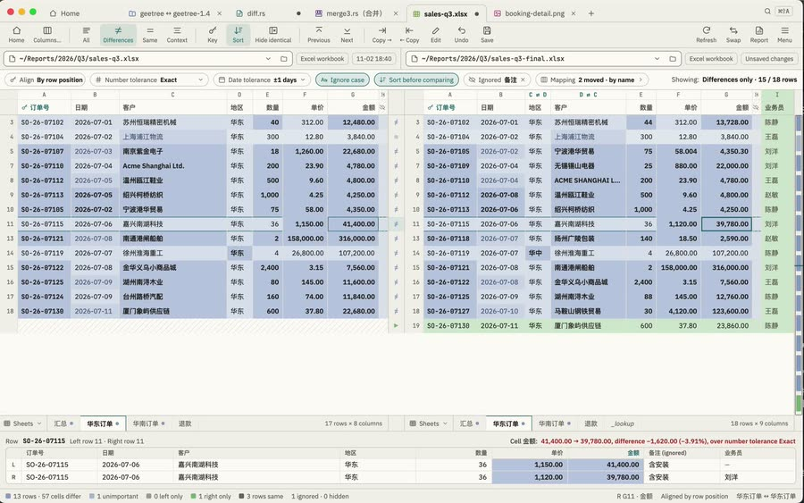</picture><br><sub>Tables</sub></td><td width="50%" align="center" valign="top"><picture><source media="(prefers-color-scheme: dark)" srcset=".github/media/hex-en-dark.jpg">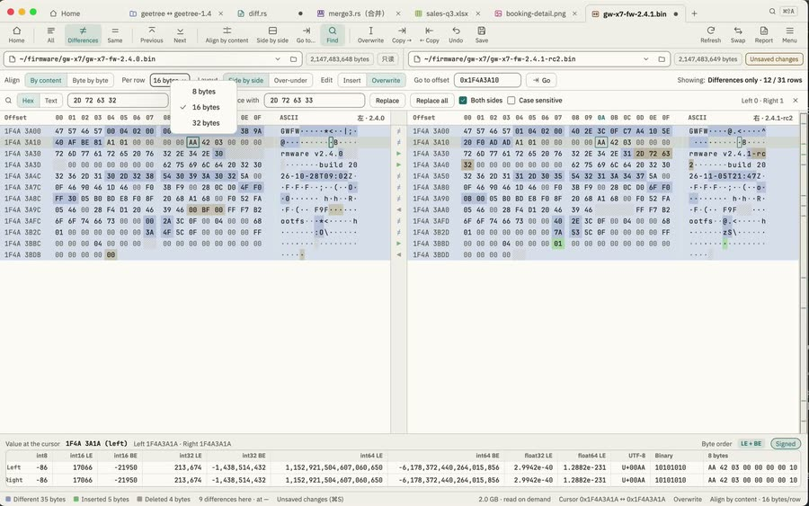</picture><br><sub>Hex</sub></td></tr>
<tr><td width="50%" align="center" valign="top"><picture><source media="(prefers-color-scheme: dark)" srcset=".github/media/picture-en-dark.jpg">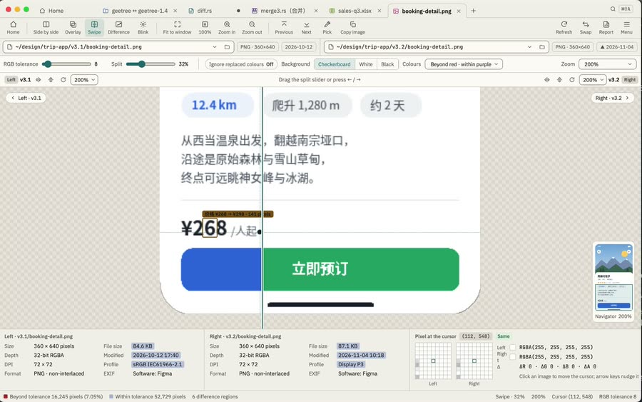</picture><br><sub>Pictures</sub></td><td width="50%" align="center" valign="top"><picture><source media="(prefers-color-scheme: dark)" srcset=".github/media/doc-en-dark.jpg">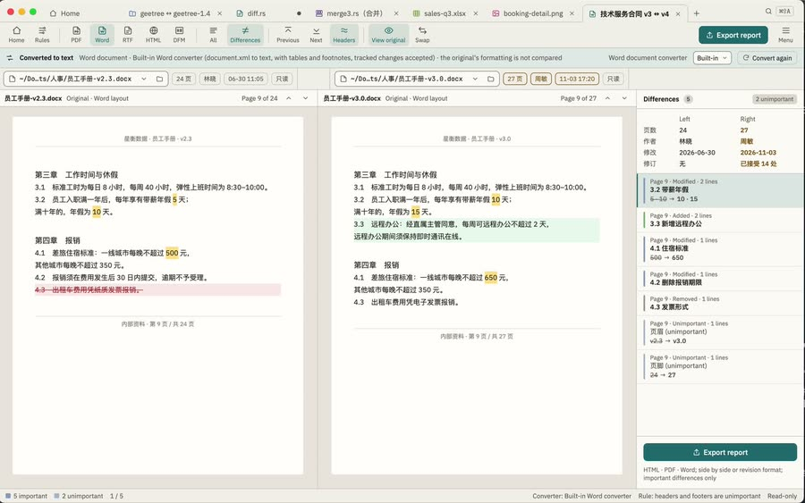</picture><br><sub>Documents</sub></td></tr>
</table>

## Wherever the files are

Archives open as folders, and zip, tar, tar.gz and 7z are written back in place (with a `.bak` kept first). SFTP, FTP/FTPS, S3, WebDAV and SVN folders are compared where they are, with resumable transfers. Any revision in Git, a file system snapshot and the clipboard are sources too.

<table>
<tr><td width="33%" align="center" valign="top"><picture><source media="(prefers-color-scheme: dark)" srcset=".github/media/archive-en-dark.jpg">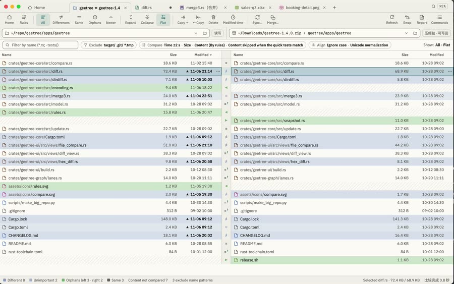</picture><br><sub>Archives</sub></td><td width="33%" align="center" valign="top"><picture><source media="(prefers-color-scheme: dark)" srcset=".github/media/remote-en-dark.jpg">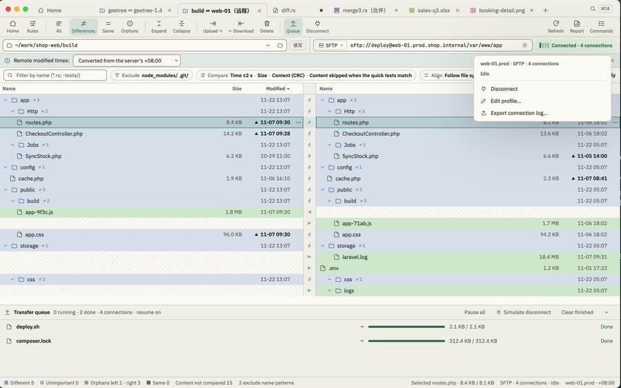</picture><br><sub>Remote</sub></td><td width="33%" align="center" valign="top"><picture><source media="(prefers-color-scheme: dark)" srcset=".github/media/git-en-dark.jpg">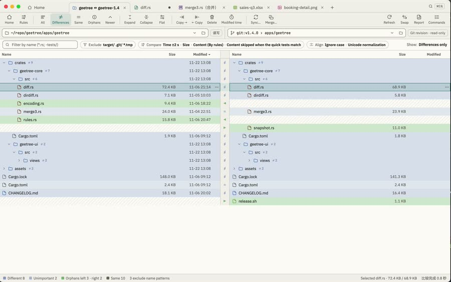</picture><br><sub>Git revisions</sub></td></tr>
</table>

## Automation and integration

The scripting language turns a comparison, a synchronisation and a report into one command, and Beyond Compare scripts can be imported. The command line always returns a meaningful exit code. Reports come as HTML, text, a patch, XML or CSV statistics. difftool and mergetool, the file manager context menu, Subversion, Mercurial and Perforce are each one click to configure.

<table>
<tr><td width="50%" align="center" valign="top"><picture><source media="(prefers-color-scheme: dark)" srcset=".github/media/script-en-dark.jpg">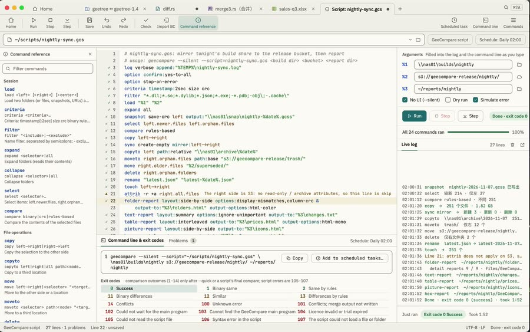</picture><br><sub>Scripts</sub></td><td width="50%" align="center" valign="top"><picture><source media="(prefers-color-scheme: dark)" srcset=".github/media/report-en-dark.jpg">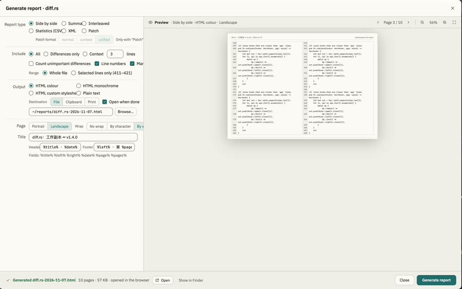</picture><br><sub>Reports</sub></td></tr>
</table>

## The same stack as Zed

<table><tr><td><b>Rust</b></td><td>Native code. No browser, no garbage-collection pauses.</td></tr><tr><td><b>GPUI</b></td><td>The UI framework behind the Zed editor. The interface is drawn by the GPU, so scrolling a large file stays under your finger.</td></tr></table>

Native on macOS, Windows and Linux, with the same interface, the same shortcuts and the same rules.

## Download

Free to use. No account needed.

| Platform | Download | Requirements |
|---|---|---|
| **macOS** | [Apple silicon](https://api.geecompare.com/dl/GeeCompare_aarch64.dmg?from=github) · [Intel](https://api.geecompare.com/dl/GeeCompare_x64.dmg?from=github) | macOS 12 or later |
| **Windows** | [Installer](https://api.geecompare.com/dl/GeeCompare_x64-setup.exe?from=github) (x64) | Windows 10 1809 or later |
| **Linux** | [AppImage](https://api.geecompare.com/dl/GeeCompare_x86_64.AppImage?from=github) · [.deb](https://api.geecompare.com/dl/GeeCompare_amd64.deb?from=github) (x64) | glibc 2.35 or later, Wayland or X11 |

**macOS**: install with [Homebrew](https://brew.sh) (it picks your chip), or open the `.dmg` and drag GeeCompare into Applications.

```sh
brew install --cask cmzy/tap/geecompare
```

**Windows**: run the installer. It installs for the current user, no admin rights needed. The text editor's web page view needs the WebView2 runtime: part of Windows 11, installed with Edge on Windows 10.

**Linux**: make the AppImage executable and run it, or install the `.deb` with your package manager.

```sh
chmod +x GeeCompare_x86_64.AppImage && ./GeeCompare_x86_64.AppImage
# or
sudo apt install ./GeeCompare_amd64.deb
```

Every release ships a `SHA256SUMS` file to verify the download against, and GeeCompare updates itself when a new version is out. The context menu, difftool and mergetool and the version control integrations are all switched on in Preferences › Integration. [All releases →](https://github.com/cmzy/geecompare/releases)

## Privacy

GeeCompare has no telemetry and no analytics: your files, their names and their contents stay on your machine. It goes online for two things — the update check (at launch and every twelve hours, carrying the version, the platform and a random id this installation made for itself, so that a day's checks count installations rather than requests; Preferences › Updates & help turns it off), and the remote sources you set up yourself. Passwords and keys for those connections are kept in the system keychain, and crash reports stay on your machine. [What is sent, in full →](https://geecompare.com/privacy/)

## Feedback

Found a bug or missing a feature? Open an [issue](https://github.com/cmzy/geecompare/issues).

---

<p align="center"><b>Try it on the two folders you have been putting off.</b><br><a href="#download">Download</a> · <a href="https://geecompare.com/">geecompare.com</a></p>

<p align="center"><sub>This repository holds GeeCompare's releases and issues; the source code is not published.</sub></p>
