<p align="center"></p>

<h1 align="center">GeeCompare</h1>

<h3 align="center">比较与合并，什么都能比。</h3>

<p align="center">文件夹、文本、表格、十六进制、图片、文档、媒体、注册表——15 种会话，一个原生应用全包。</p>

<p align="center">
  <a href="https://github.com/cmzy/geecompare/releases/latest"></a>
  
  
  
</p>

<p align="center">
  <a href="#下载"><b>下载</b></a> ·
  <a href="https://geecompare.com/cn/">官网</a> ·
  <a href="https://geecompare.com/cn/docs/">文档</a> ·
  <a href="https://github.com/cmzy/geecompare/releases">全部版本</a> ·
  <a href="https://github.com/cmzy/geecompare/issues">问题反馈</a> ·
  <a href="README.md">English</a>
</p>

<p align="center"><a href="https://geecompare.com/cn/">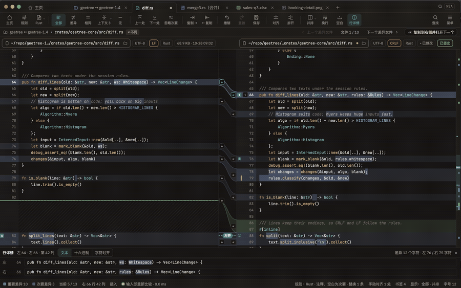</a></p>

<table align="center"><tr><td align="center"><h3>15</h3><sub>种会话：文件夹、文本、表格、图片、文档…</sub></td><td align="center"><h3>12</h3><sub>类归档，免解压直接比，还能写回</sub></td><td align="center"><h3>5</h3><sub>SFTP · FTP/FTPS · S3 · WebDAV · SVN</sub></td><td align="center"><h3>3</h3><sub>macOS · Windows · Linux</sub></td></tr></table>

免费使用，无需注册。

## 文件夹：比较、同步、合并

**规则说了算，结果一眼看清。** 按大小、时间、校验和或逐字节比较；过滤、扁平视图、F7 跳到下一处差异。复制、移动、改名、删除都在后台跑，能暂停、能取消，删除一律进回收站。

<picture><source media="(prefers-color-scheme: dark)" srcset=".github/media/folder-zh-dark.gif">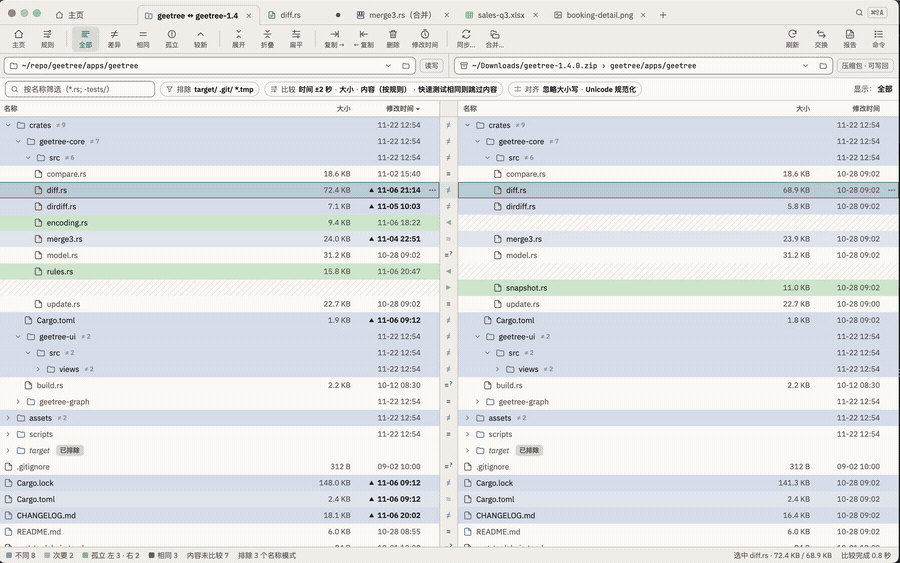</picture>

五种同步方式先预览再执行，两路和三路文件夹合并给的是一份可以改的计划。

<table>
<tr><td width="50%" align="center" valign="top"><picture><source media="(prefers-color-scheme: dark)" srcset=".github/media/sync-zh-dark.jpg">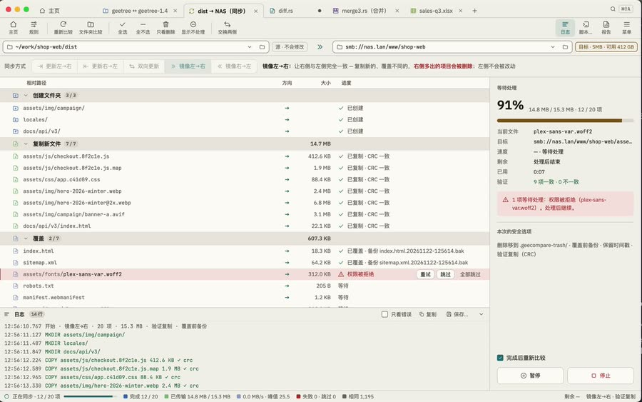</picture><br><sub>同步</sub></td><td width="50%" align="center" valign="top"><picture><source media="(prefers-color-scheme: dark)" srcset=".github/media/foldermerge-zh-dark.jpg">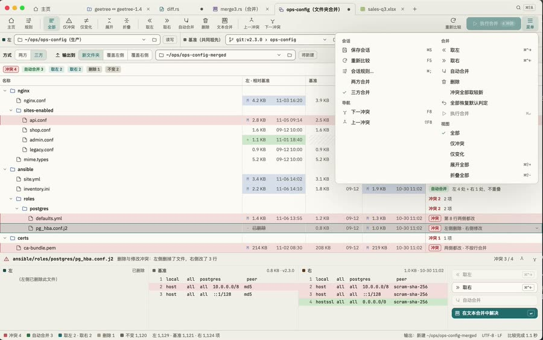</picture><br><sub>文件夹合并</sub></td></tr>
</table>

## 文本：边改边比，差异当场重算

两侧都能编辑，输入即重新比较。重要差异与次要差异分开着色，规则一处处调：大小写、空白、注释、替换规则、按语法对齐。

<picture><source media="(prefers-color-scheme: dark)" srcset=".github/media/text-zh-dark.gif">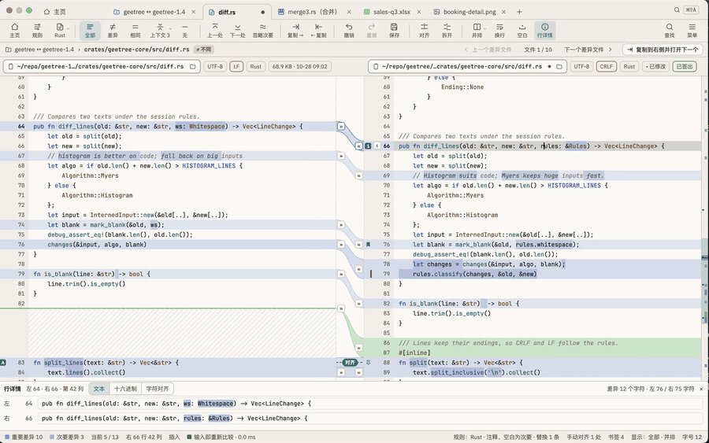</picture>

并排、上下、统一三种布局，连接线、书签、手动对齐、查找替换一应俱全。

<table>
<tr><td width="100%" align="center" valign="top"><picture><source media="(prefers-color-scheme: dark)" srcset=".github/media/textrules-zh-dark.jpg">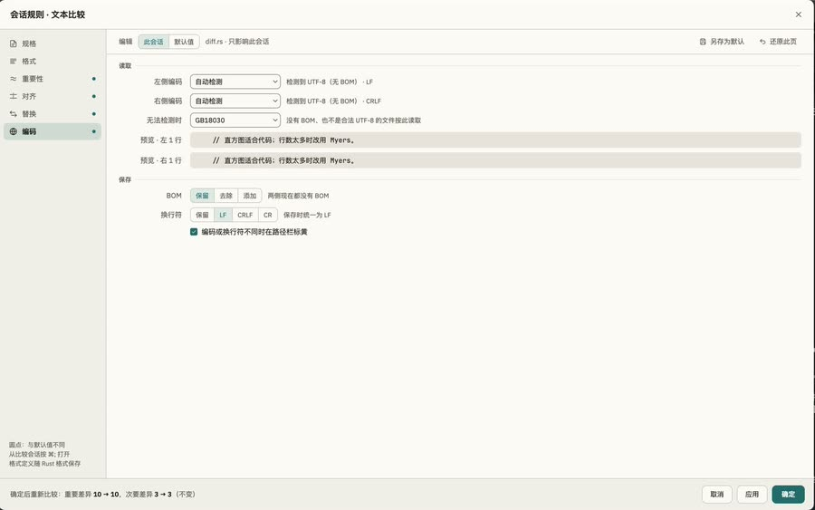</picture><br><sub>会话规则：差异数随规则实时重算</sub></td></tr>
</table>

## 三方合并与补丁

三方合并带独立的输出面板，冲突一处处过，可以从 `git mergetool` 直接打开；两路合并同理。

<picture><source media="(prefers-color-scheme: dark)" srcset=".github/media/merge-zh-dark.gif">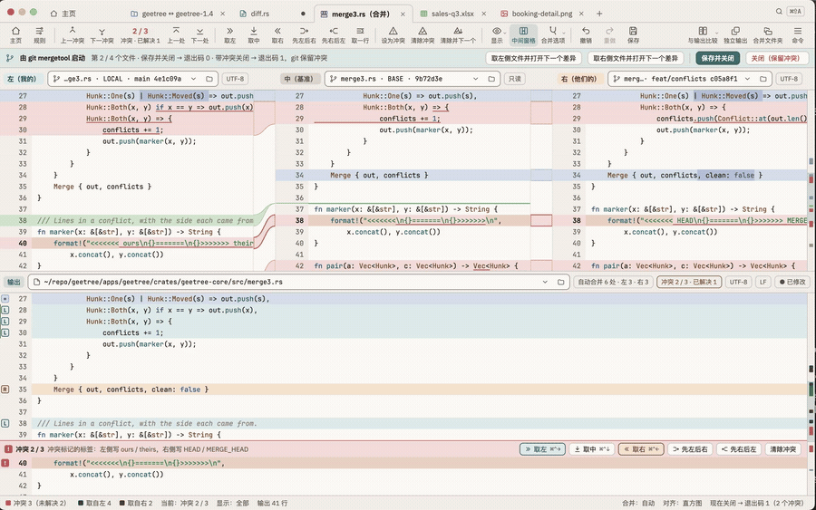</picture>

<table>
<tr><td width="100%" align="center" valign="top"><picture><source media="(prefers-color-scheme: dark)" srcset=".github/media/patch-zh-dark.jpg">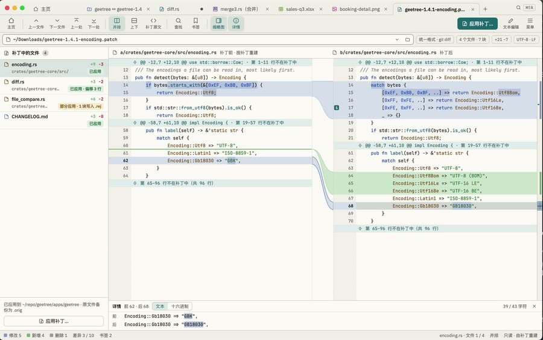</picture><br><sub>补丁文件并排查看，也能应用到工作目录</sub></td></tr>
</table>

## 不只是文本

表格与 Excel（多工作表、主键列、容差、列映射），十六进制（可编辑、对齐、数值栏），图片（并排、叠加、擦除、差异、闪烁、像素放大镜），PDF、Word、RTF、HTML 转成文本后比较，媒体标签、可执行文件版本信息，以及注册表。

<table>
<tr><td width="50%" align="center" valign="top"><picture><source media="(prefers-color-scheme: dark)" srcset=".github/media/table-zh-dark.jpg">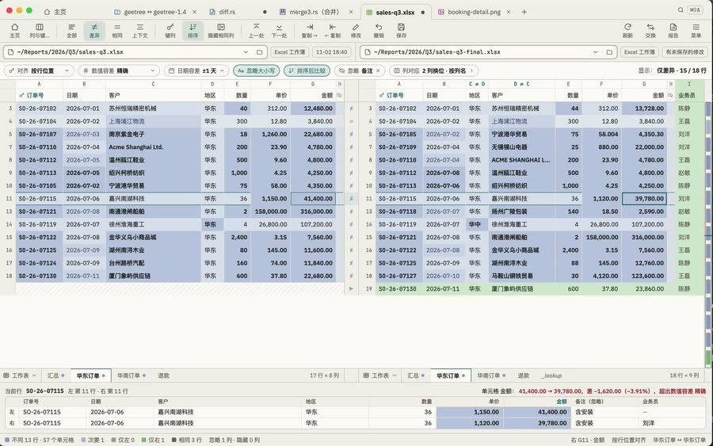</picture><br><sub>表格</sub></td><td width="50%" align="center" valign="top"><picture><source media="(prefers-color-scheme: dark)" srcset=".github/media/hex-zh-dark.jpg">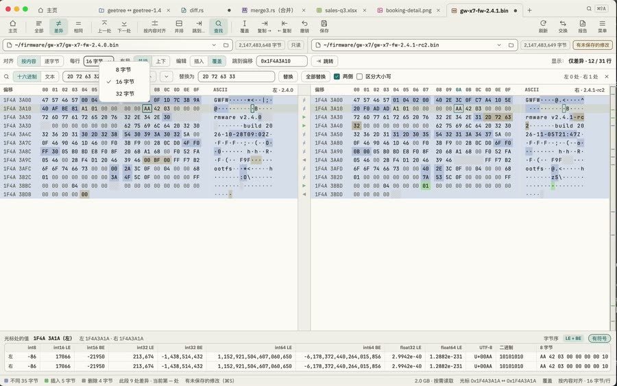</picture><br><sub>十六进制</sub></td></tr>
<tr><td width="50%" align="center" valign="top"><picture><source media="(prefers-color-scheme: dark)" srcset=".github/media/picture-zh-dark.jpg">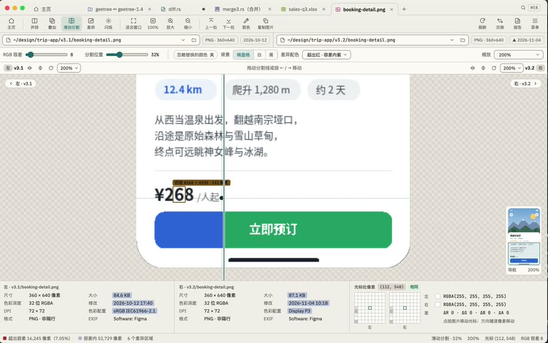</picture><br><sub>图片</sub></td><td width="50%" align="center" valign="top"><picture><source media="(prefers-color-scheme: dark)" srcset=".github/media/doc-zh-dark.jpg">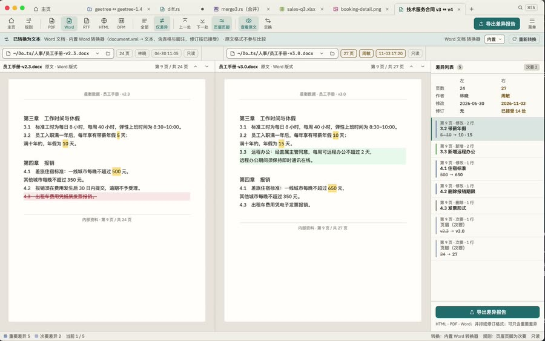</picture><br><sub>文档</sub></td></tr>
</table>

## 哪来的都能比

压缩包当文件夹用，zip、tar、tar.gz 和 7z 还能直接写回（写回前自动留 `.bak`）；SFTP、FTP/FTPS、S3、WebDAV、SVN 远程目录直接比，传输可断点续传；Git 的任意版本、文件系统快照、剪贴板，都是一侧的来源。

<table>
<tr><td width="33%" align="center" valign="top"><picture><source media="(prefers-color-scheme: dark)" srcset=".github/media/archive-zh-dark.jpg">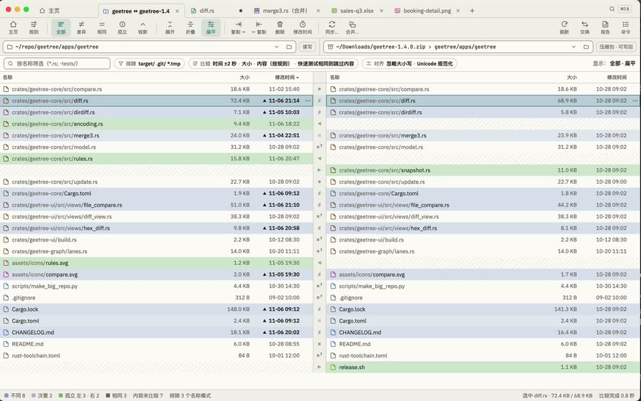</picture><br><sub>压缩包</sub></td><td width="33%" align="center" valign="top"><picture><source media="(prefers-color-scheme: dark)" srcset=".github/media/remote-zh-dark.jpg">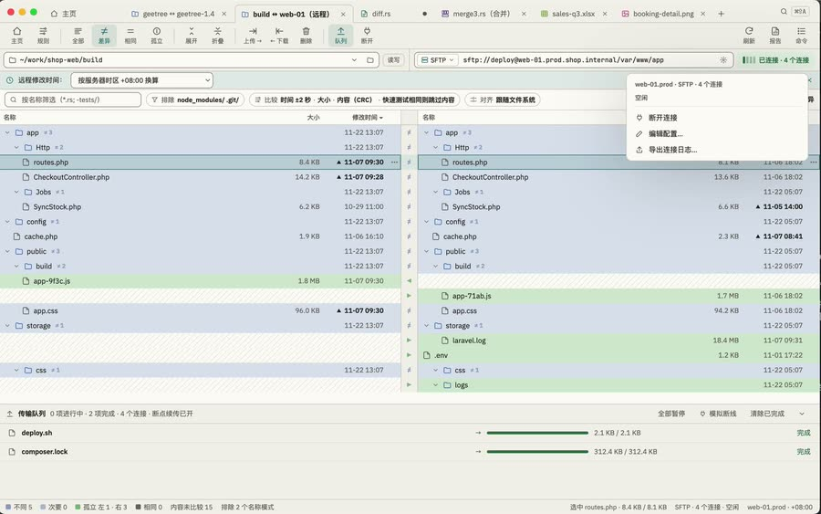</picture><br><sub>远程</sub></td><td width="33%" align="center" valign="top"><picture><source media="(prefers-color-scheme: dark)" srcset=".github/media/git-zh-dark.jpg">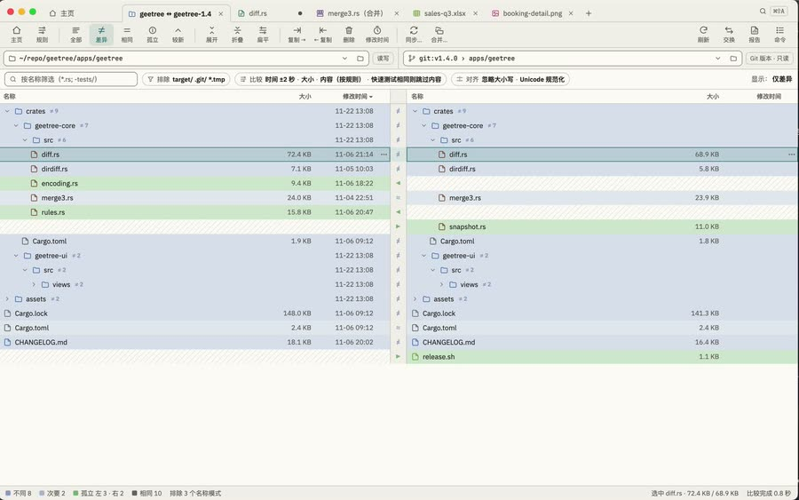</picture><br><sub>Git 版本</sub></td></tr>
</table>

## 自动化与集成

脚本语言能把比较、同步和报告写成一条命令，Beyond Compare 的脚本可以导入；命令行永远返回有意义的退出码；报告支持 HTML、文本、补丁、XML 和 CSV 统计。difftool / mergetool、文件管理器右键菜单、Subversion、Mercurial、Perforce 都能一键配置。

<table>
<tr><td width="50%" align="center" valign="top"><picture><source media="(prefers-color-scheme: dark)" srcset=".github/media/script-zh-dark.jpg">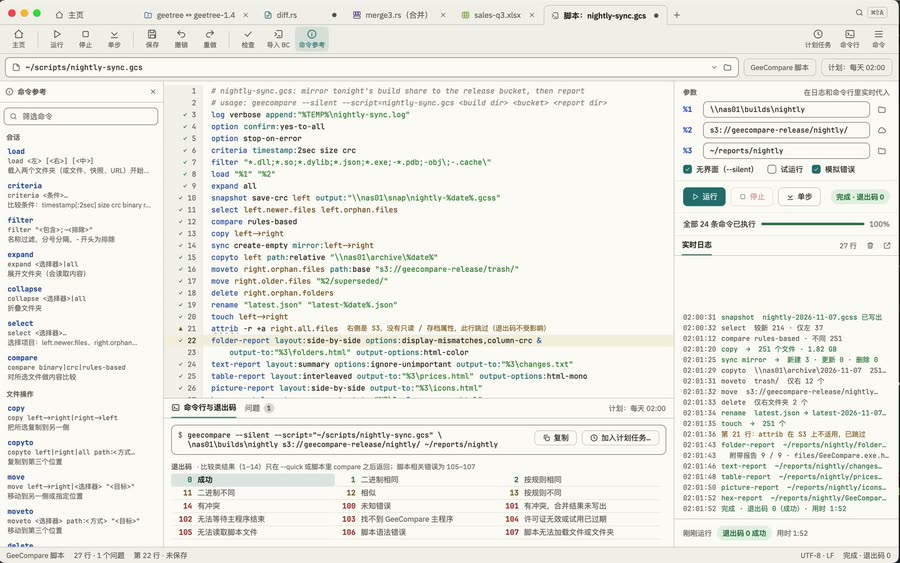</picture><br><sub>脚本</sub></td><td width="50%" align="center" valign="top"><picture><source media="(prefers-color-scheme: dark)" srcset=".github/media/report-zh-dark.jpg">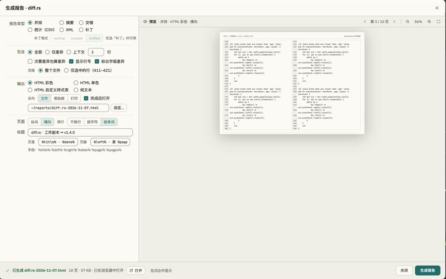</picture><br><sub>报告</sub></td></tr>
</table>

## 和 Zed 同一套技术栈

<table><tr><td><b>Rust</b></td><td>原生代码，没有浏览器，没有垃圾回收停顿。</td></tr><tr><td><b>GPUI</b></td><td>Zed 编辑器的 UI 框架，界面由 GPU 绘制，大文件滚动依旧跟手。</td></tr></table>

macOS、Windows、Linux 上都是原生程序，界面、快捷键和规则完全一致。

## 下载

免费使用，无需注册。

| 平台 | 下载 | 系统要求 |
|---|---|---|
| **macOS** | [Apple 芯片](https://api.geecompare.com/dl/GeeCompare_aarch64.dmg?from=github) · [Intel](https://api.geecompare.com/dl/GeeCompare_x64.dmg?from=github) | macOS 12 及以上 |
| **Windows** | [安装程序](https://api.geecompare.com/dl/GeeCompare_x64-setup.exe?from=github)（x64） | Windows 10 1809 及以上 |
| **Linux** | [AppImage](https://api.geecompare.com/dl/GeeCompare_x86_64.AppImage?from=github) · [.deb](https://api.geecompare.com/dl/GeeCompare_amd64.deb?from=github)（x64） | glibc 2.35 及以上，Wayland 或 X11 |

**macOS**：用 [Homebrew](https://brew.sh) 安装（自动选择芯片），或者打开 `.dmg` 把 GeeCompare 拖进「应用程序」。

```sh
brew install --cask cmzy/tap/geecompare
```

**Windows**：运行安装程序即可，装到当前用户，不需要管理员权限。文本编辑器的网页视图需要 WebView2 运行时：Windows 11 自带，Windows 10 随 Edge 一起安装。

**Linux**：AppImage 加上执行权限直接运行，或者用系统的包管理器安装 `.deb`。

```sh
chmod +x GeeCompare_x86_64.AppImage && ./GeeCompare_x86_64.AppImage
# 或者
sudo apt install ./GeeCompare_amd64.deb
```

每个版本都附带 `SHA256SUMS` 供校验，有新版本时 GeeCompare 会自己更新。右键菜单、difftool / mergetool 和版本控制的集成都在「偏好设置 › 集成」里开关。[全部版本 →](https://github.com/cmzy/geecompare/releases)

## 隐私

GeeCompare 没有遥测，也没有使用统计：你的文件、文件名和内容都留在本机。联网只有两件事——更新检查（启动时以及之后每 12 小时一次，只带版本、平台和这个安装自己生成的随机 id，好让一天的检查按安装数而不是请求数来计；在「偏好设置 › 更新与帮助」里可以关掉），以及你自己配置的远程连接。远程连接的密码和密钥存在系统钥匙串里，崩溃报告只留在本机。[完整说明 →](https://geecompare.com/cn/privacy/)

## 问题反馈

发现 bug 或者缺少某个功能？来提一个 [issue](https://github.com/cmzy/geecompare/issues)。

---

<p align="center"><b>拿你手上最难比的两个目录试试。</b><br><a href="#下载">下载</a> · <a href="https://geecompare.com/cn/">geecompare.com</a></p>

<p align="center"><sub>这个仓库放的是 GeeCompare 的发布版本和问题反馈，源代码未公开。</sub></p>
